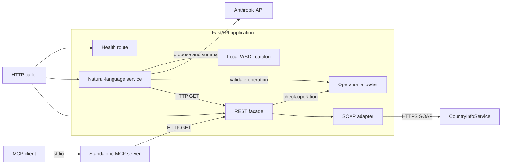
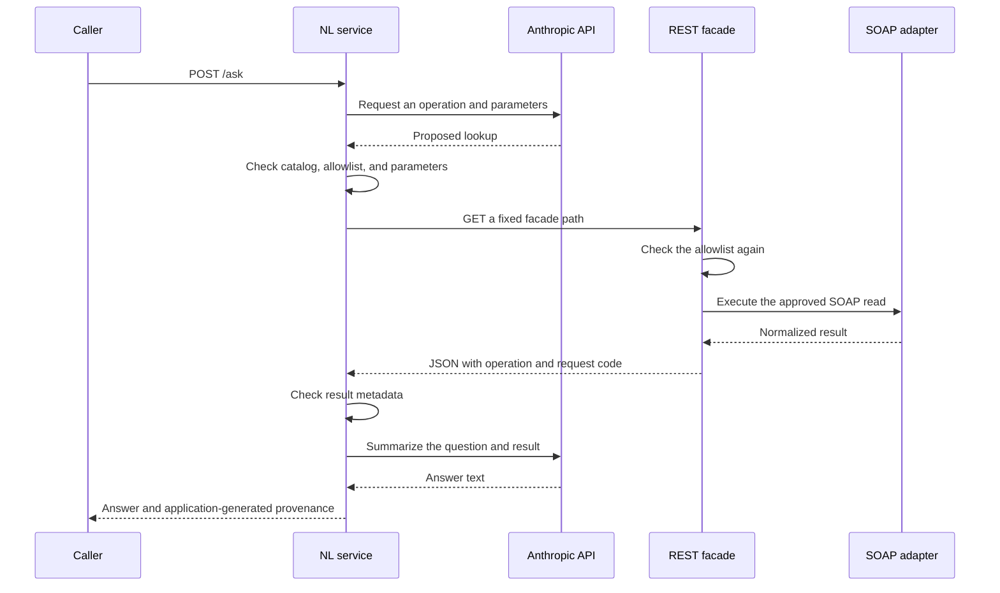

# SOAP-to-REST AI Bridge

A Python 3.11 service that exposes five read-only operations from the public CountryInfoService SOAP API as JSON endpoints. Its optional `POST /ask` endpoint accepts a natural-language question and returns an answer with the operation, parameters, and REST path used to retrieve the data.

## Table of Contents

- [Project Overview](#project-overview)
- [Technology Stack](#technology-stack)
- [High-Level Logical Architecture](#high-level-logical-architecture)
- [Component Inventory](#component-inventory)
- [Repository Structure](#repository-structure)
- [Application Execution Flow](#application-execution-flow)
- [Development Prerequisites](#development-prerequisites)
- [Local Development Setup](#local-development-setup)
- [Build Instructions](#build-instructions)
- [Running the Application](#running-the-application)
- [Testing](#testing)
- [Configuration](#configuration)
- [APIs and Interfaces](#apis-and-interfaces)
- [MCP Server and Five-Tool Demo](#mcp-server-and-five-tool-demo)
- [Deployment Architecture](#deployment-architecture)
- [Troubleshooting](#troubleshooting)
- [Development Guidelines](#development-guidelines)
- [Known Limitations](#known-limitations)
- [AWS Deployment Options](#aws-deployment-options)
- [Production Security on AWS](#production-security-on-aws)

## Project Overview

Use the REST API to look up a country's capital, currency, phone code, or full record, or to list countries using a currency. Use `/ask` when the caller has a question in natural language. The model proposes a lookup, application code validates it, and the REST facade performs the approved read. The REST routes work independently of Anthropic.

## Technology Stack

- **API and runtime** — FastAPI and Uvicorn on Python 3.11, with Pydantic Settings for configuration.
- **Integrations** — Zeep for WSDL and SOAP parsing, HTTPX for async HTTP, and the Anthropic Python SDK for the natural-language workflow.
- **MCP** — The official Python MCP SDK serves the five facade lookups over stdio.
- **Development and deployment** — uv and Hatchling for dependency management and packaging, pytest and pytest-asyncio for tests, and Caddy for the optional HTTPS demo. [Project manifest](pyproject.toml), [lockfile](uv.lock), [Caddyfile](Caddyfile)

## High-Level Logical Architecture



## Component Inventory

| Component | Responsibility | Source |
| --- | --- | --- |
| HTTP API and lifespan | Registers health, REST, and `/ask` routes and manages integration clients | [main.py](src/soap_rest_ai/main.py), [api/](src/soap_rest_ai/api) |
| MCP server | Validates tool input, calls the REST facade, and returns typed results over stdio | [mcp_server.py](src/soap_rest_ai/mcp_server.py) |
| Natural-language service | Requests an operation, validates its inputs, calls the facade, and builds the answer response | [nl/](src/soap_rest_ai/nl) |
| Policy | Enforces the fixed allowlist and any narrower configured subset | [operations.py](src/soap_rest_ai/policy/operations.py) |
| SOAP adapter | Loads and checks the WSDL, calls the approved service endpoint, and normalizes SOAP results | [soap/](src/soap_rest_ai/soap) |
| Catalog | Supplies WSDL-derived operation metadata for model routing | [countryinfo_catalog.json](data/countryinfo_catalog.json) |

## Repository Structure

- [src/soap_rest_ai/](src/soap_rest_ai) — application code and CLI tools. The [SOAP check](src/soap_rest_ai/soap/validate_live.py) probes the upstream, the [catalog refresh](src/soap_rest_ai/soap/refresh_catalog.py) regenerates routing metadata, and the [NL check](src/soap_rest_ai/nl/validate_live.py) exercises the running app.
- [data/](data) — local operation catalog and saved evaluation artifacts.
- [tests/](tests) — offline API, policy, and integration tests using [WSDL and XML fixtures](tests/fixtures/README.md).

## Application Execution Flow

FastAPI loads settings and creates the SOAP and natural-language services on startup. The WSDL, catalog, and Anthropic client initialize when first needed. Application-owned clients close on shutdown. [Application lifespan](src/soap_rest_ai/main.py), [NL service](src/soap_rest_ai/nl/service.py)



The configured allowlist can narrow the five approved operations. The application constructs the REST path from the validated operation and parameters. [NL service](src/soap_rest_ai/nl/service.py), [execution mapping](src/soap_rest_ai/nl/execution.py)

## Development Prerequisites

Install Python 3.11 and uv. Live data requires a self-contained WSDL that declares a reachable HTTPS SOAP address. Live `/ask` also requires an Anthropic API key and access to the configured models.

## Local Development Setup

From the repository root, install the locked dependencies.

```sh
uv sync --frozen --python 3.11
```

On a fresh checkout, copy [.env.example](.env.example) to `.env`. In PowerShell, use `Copy-Item .env.example .env`. In a POSIX shell, use `cp .env.example .env`. The example configuration supports startup and `/health`.

For live REST calls, set `SOAP_WSDL_URL` to a trusted WSDL URL or file. If using a file, also set `SOAP_ENDPOINT_URL` to the exact HTTPS SOAP address declared in it. Verify the configured upstream with `uv run python -m soap_rest_ai.soap.validate_live`. For `/ask`, set the Anthropic key and both model IDs privately.

The [demo setup](DEMO.md#preparation-outside-the-clock) lists the public CountryInfoService WSDL URL. Run the upstream check before relying on it for live requests.

## Build Instructions

Local development runs from the source tree after `uv sync`. Hatchling packages `src/soap_rest_ai` in the wheel. For wheel-based deployments, ship the catalog separately and point `WSDL_CATALOG_PATH` at it. [Build configuration](pyproject.toml)

## Running the Application

```sh
uv run uvicorn soap_rest_ai.main:app --host 127.0.0.1 --port 8000
```

Open [health](http://127.0.0.1:8000/health) for `{"status":"ok"}` or [Swagger UI](http://127.0.0.1:8000/docs) to try the routes. Stop Uvicorn with Ctrl+C. Restart it after changing configuration or replacing the catalog.

## Testing

Run the offline suite after installing the locked dependencies. It blocks external HTTP and uses fixtures and mock transports for SOAP and model calls. [Test configuration](tests/conftest.py)

```sh
uv --offline run --frozen pytest -q
```

[Baseline results](data/evals/runs/baseline/report.md) · [Rerun results](data/evals/runs/improved-01/report.md)

## Configuration

The app reads environment variables and an optional `.env` file. Keep credentials out of version control. [Settings](src/soap_rest_ai/config.py)

| Setting | Default | Purpose |
| --- | --- | --- |
| `SOAP_WSDL_URL` | Empty | HTTPS WSDL URL or trusted local WSDL path. The public demo opt-in also accepts its exact HTTP WSDL URL. |
| `SOAP_ENDPOINT_URL` | Empty | Exact SOAP address from the WSDL. Required for a local WSDL. A remote HTTPS WSDL defaults to its own HTTPS origin. The HTTP demo pins the exact public SOAP endpoint. |
| `SOAP_ALLOW_PUBLIC_HTTP_DEMO` | `false` | Allow the two pinned HTTP URLs for the public CountryInfoService demo |
| `SOAP_TIMEOUT_SECONDS` | `10` | HTTP timeout per phase |
| `SOAP_MAX_RETRIES` | `1` | Additional attempts for eligible transient SOAP failures |
| `FACADE_BASE_URL` | `http://127.0.0.1:8000` | Base URL for the natural-language service's HTTP calls to the facade |
| `WSDL_CATALOG_PATH` | `data/countryinfo_catalog.json` | Local operation catalog used by `/ask` |
| `ALLOWED_OPERATIONS` | All five operations below | JSON array that narrows the approved set |
| `ANTHROPIC_API_KEY` | Unset | Secret for live `/ask` requests |
| `ANTHROPIC_ROUTER_MODEL` | Empty | Operation-selection model |
| `ANTHROPIC_ANSWER_MODEL` | Empty | Answer-generation model |
| `DEMO_MODE` | `false` | Enables the single-worker demo's admission controls |
| `DEMO_DAILY_ASK_LIMIT` | `60` | Demo worker's shared daily `/ask` admission limit, measured in UTC |

## APIs and Interfaces

| Route | SOAP operation | Result field |
| --- | --- | --- |
| `GET /countries/{iso_code}/capital` | `CapitalCity` | `capital` |
| `GET /countries/{iso_code}/currency` | `CountryCurrency` | `currency` |
| `GET /countries/{iso_code}/phone-code` | `CountryIntPhoneCode` | `phone_code` |
| `GET /countries/{iso_code}` | `FullCountryInfo` | `country` |
| `GET /currencies/{currency_code}/countries` | `CountriesUsingCurrency` | `countries` |

Country codes take two ASCII letters and currency codes take three. Responses include the operation and normalized request code. `GET /health` checks process availability. `POST /ask` accepts a nonblank `question` up to 2,000 characters and returns `answer` plus `provenance`. [REST routes](src/soap_rest_ai/api/facade.py), [request and response models](src/soap_rest_ai/nl/models.py)

With the live integrations configured, try these requests in PowerShell.

```powershell
Invoke-RestMethod http://127.0.0.1:8000/countries/JP/capital
$body = @{ question = 'What is the capital of Japan?' } | ConvertTo-Json
Invoke-RestMethod -Method Post -Uri http://127.0.0.1:8000/ask -ContentType 'application/json' -Body $body
```

## MCP Server and Five-Tool Demo

The MCP client starts a separate process from the repository root with this command.

```sh
uv run python -m soap_rest_ai.mcp_server
```

The server reads `MCP_FACADE_BASE_URL` from its process environment. It defaults to `http://127.0.0.1:8000`. Set it in the MCP client's launch environment if FastAPI uses another address. The MCP server can initialize and list tools while FastAPI is offline. It reuses one async HTTP client for tool calls and closes it on shutdown. Stdout carries MCP messages and logs go to stderr.

Each tool trims its input, checks for two ASCII letters for a country code or three for a currency code, and sends an uppercase code via a fixed REST GET route. The facade determines the lookup result. Each structured result and its JSON text equivalent contain `success`, the SOAP `operation`, the normalized `input` object, and `data` from the corresponding REST result field. A successful lookup can return `data: null`. Failures set `isError: true`, return `data: null`, and include an `error` with a stable `code` and a sanitized `message`. Locally rejected input is represented by `input: null`. [Python MCP SDK result handling](https://github.com/modelcontextprotocol/python-sdk/blob/v1.30.0/src/mcp/server/lowlevel/server.py)

There are at most two HTTP attempts, with a three-second limit per attempt and a seven-second deadline that includes the retry wait. Transient connection errors, timeouts, and eligible HTTP 502, 503, and 504 responses retry after 250 ms. Facade error metadata can stop retries, including for SOAP faults. Direct and upstream HTTP 429 responses require a valid `Retry-After` that leaves time for another attempt. The wait is at least 250 ms. The current facade reports SOAP upstream 429 in its error metadata without forwarding the SOAP response's `Retry-After`, so those calls return a rate-limit error immediately.

1. Start FastAPI from the repository root with the public CountryInfoService HTTP demo enabled. The WSDL and SOAP messages travel in plaintext in this mode, so a network intermediary could read or alter them. Use this mode for the public-data demo.

   ```powershell
   $env:SOAP_ALLOW_PUBLIC_HTTP_DEMO = 'true'
   $env:SOAP_WSDL_URL = 'http://webservices.oorsprong.org/websamples.countryinfo/CountryInfoService.wso?WSDL'
   $env:SOAP_ENDPOINT_URL = 'http://webservices.oorsprong.org/websamples.countryinfo/CountryInfoService.wso'
   uv run uvicorn soap_rest_ai.main:app --host 127.0.0.1 --port 8000
   ```

2. In a second terminal at the repository root, run `npx @modelcontextprotocol/inspector uv run python -m soap_rest_ai.mcp_server`. Connect over STDIO and list tools. [MCP Inspector](https://modelcontextprotocol.io/docs/tools/inspector)
3. Call all five tools and inspect the structured results.

   - `get_country_capital` with `{"country_code":" ph "}` reads `/countries/PH/capital` and returns the `capital` string.
   - `get_country_currency` with `{"country_code":"PH"}` reads `/countries/PH/currency` and returns the `currency` object.
   - `get_country_phone_code` with `{"country_code":"PH"}` reads `/countries/PH/phone-code` and returns the `phone_code` string.
   - `get_country_info` with `{"country_code":"PH"}` reads `/countries/PH` and returns the `country` object.
   - `get_countries_by_currency` with `{"currency_code":"PHP"}` reads `/currencies/PHP/countries` and returns the `countries` list.

Run the offline MCP checks with `uv --offline run --frozen pytest tests/test_mcp_server.py -q`. The subprocess test discovers all five tools with the Python MCP client, then calls a tool over stdio against a loopback stub facade.

**Live acceptance passed on 2026-11-17.** The Python MCP client discovered all five tools over stdio and verified all five results through local FastAPI and the public SOAP provider with the HTTP demo opt-in enabled. HTTPS probes to the provider reset during the TLS handshake.

## Deployment Architecture

The default local profile binds Uvicorn to loopback. For an invite-only HTTPS instance, install and run Caddy on the same host. [Caddy installation](https://caddyserver.com/docs/install)

1. Point the hostname at the host and allow TCP 80 and 443. Keep port 8000 on loopback.
2. Generate a hash for each invite with `caddy hash-password`. Store one `username hash` per line in a private `.demo-users` file beside [Caddyfile](Caddyfile).
3. Set `DEMO_MODE=true` and start the app with `uv run uvicorn soap_rest_ai.main:app --host 127.0.0.1 --port 8000 --workers 1 --no-proxy-headers`. Set `DEMO_HOST` to the hostname for the Caddy process, then run `caddy run --config Caddyfile --adapter caddyfile`.
4. Verify that unauthenticated HTTPS requests to `/health` receive `401` and authenticated requests receive `200`.

Caddy authenticates incoming requests. The app applies a body-size limit, per-invite rate limit, concurrency limit, and daily quota to `/ask`. Counters are held in memory and reset on restart. [Demo middleware](src/soap_rest_ai/api/demo.py)

## Troubleshooting

| Symptom | Check |
| --- | --- |
| `/health` works, but SOAP requests fail | Verify the declared endpoint, TLS connectivity from the app host, and `SOAP_ENDPOINT_URL` if configured. The bundled [public WSDL fixture](tests/fixtures/countryinfo.wsdl) declares HTTP addresses and is used for offline tests and catalog reproduction. |
| `/ask` returns `503 nl_not_configured` | Set the Anthropic key and both model IDs, then restart. |
| `/ask` returns `503 catalog_unavailable` | Check the working directory and `WSDL_CATALOG_PATH`. |
| `/ask` cannot reach the facade | Match `FACADE_BASE_URL` to the Uvicorn listener and port. |

## Development Guidelines

Keep API, SOAP, natural-language, and policy responsibilities separate. Use async network I/O and keep external dependencies replaceable in tests. Add tests for new behavior. [Repository guidance](AGENTS.md)

Write descriptive commit messages and PR descriptions. A commit body should cover each change and its purpose. A PR description should cover each included change and how it was verified.

## Known Limitations

Each question runs at most one approved read. Answer text is model-generated and grounding is prompt-based. Code checks the format of country and currency codes, with lookup results determined by the upstream service. The application uses per-call timeouts and bounded SOAP retries. A deployment-wide deadline and shared quota require additional controls.

## AWS Deployment Options

The options below are deployment designs. The repository supplies the Python service and Caddy configuration. Before deploying, confirm that the WSDL and its declared SOAP endpoint work over HTTPS from the chosen AWS Region. Anthropic API usage for `/ask` is billed separately. A REST-only deployment can leave model settings unset. [Anthropic pricing](https://platform.claude.com/docs/en/about-claude/pricing)

### Free-plan demo on Amazon EC2

Eligible new AWS accounts receive USD 100 in credits and can earn up to USD 100 more. The AWS Free plan ends after six months or when credits run out, whichever comes first. Confirm the instance type, Linux AMI, storage, and credit eligibility in the console. [AWS Free plan terms](https://docs.aws.amazon.com/awsaccountbilling/latest/aboutv2/free-tier-plans.html), [EC2 Free Tier eligibility](https://docs.aws.amazon.com/AWSEC2/latest/UserGuide/ec2-free-tier-usage.html)

1. Launch one eligible Linux EC2 instance with outbound HTTPS and configure it as a Systems Manager managed node. Keep inbound ports closed for a private demo.
2. Copy the source and catalog to the VM, keeping your local `.env` out of the copy. Install Python 3.11 and uv, run the locked setup, set the app environment privately, and start Uvicorn on `127.0.0.1:8000` with `DEMO_MODE=false`.
3. Use Session Manager port forwarding to access port 8000. For an invite-only HTTPS demo instead, assign a public address and DNS name and follow the [Caddy setup](#deployment-architecture). [Session Manager port forwarding](https://docs.aws.amazon.com/systems-manager/latest/userguide/session-manager-working-with-sessions-start.html#sessions-start-port-forwarding)
4. Check `/health`, then test a configured SOAP read. When the demo ends, terminate the instance and remove any retained EBS volumes, snapshots, and unused allocated IPs.

### Low-cost paid VM on Amazon Lightsail

Launch a Linux Lightsail instance and follow the same source setup and Caddy deployment. Attach a static IP, point DNS to it, and expose TCP 80 and 443. Scope SSH to an administrative IP if you enable it. AWS lists the 1 GB Linux bundle with public IPv4 at **USD 7/month**. Check the price and transfer allowance in your Region and budget for any snapshots, domain costs, and model usage. You manage OS patching and process restarts. [Lightsail pricing](https://aws.amazon.com/lightsail/pricing/), [Static IP setup](https://docs.aws.amazon.com/lightsail/latest/userguide/lightsail-create-static-ip.html)

### Paid production on Amazon ECS with Fargate

1. Create a Linux container image with Python 3.11, the locked runtime dependencies, the application, and the catalog. Set the working directory so `WSDL_CATALOG_PATH` resolves to the packaged catalog, or use an absolute path. Run Uvicorn as a non-root user on `0.0.0.0:8000` and publish the image to private Amazon ECR. Exclude `.env` and credentials from the image.
2. Run at least two Fargate tasks across two Availability Zones in private subnets with public IPs disabled. Use an Application Load Balancer (ALB) with an AWS Certificate Manager (ACM) certificate and an IP target group on port 8000. Restrict task ingress on 8000 to the ALB security group and configure `/health` as the target health check. [ECS load balancing](https://docs.aws.amazon.com/AmazonECS/latest/developerguide/alb.html), [ECS task networking](https://docs.aws.amazon.com/AmazonECS/latest/developerguide/task-networking-awsvpc.html)
3. Set `FACADE_BASE_URL=http://127.0.0.1:8000` so each task calls its local facade. Set `NO_PROXY=127.0.0.1,localhost` if a task uses an environment HTTP proxy. Enable the production controls below and run with `DEMO_MODE=false`. Provide outbound HTTPS through NAT for the public SOAP and Anthropic endpoints, and use NAT or VPC endpoints for required AWS services.
4. Verify healthy targets in staging, test a SOAP-backed read from inside the task or through protected ingress, and test authenticated `/ask` if enabled. Keep the previous task definition and image digest for rollback.

Estimate regional costs for task CPU and memory, ALB, NAT and transfer, registry storage, secrets, and monitoring. Include any WAF, firewall, and VPC endpoint charges. Set actual and forecast alerts with AWS Budgets and track model spend separately. [AWS Pricing Calculator](https://calculator.aws/), [Fargate pricing](https://aws.amazon.com/fargate/pricing/), [ALB pricing](https://aws.amazon.com/elasticloadbalancing/pricing/), [VPC pricing](https://aws.amazon.com/vpc/pricing/), [AWS Budgets](https://docs.aws.amazon.com/cost-management/latest/userguide/budgets-managing-costs.html)

## Production Security on AWS

- **Authenticate exposed routes.** With a public ALB, terminate external HTTPS there using ACM and validate bearer tokens in the application. Verify the signature, issuer, audience, expiry, and route scopes. If API Gateway enforces JWTs, use a VPC link to an internal ALB and allow listener traffic only from the VPC link's security group. Keep `/health` available to the target group and keep Swagger/OpenAPI private. For an `/ask`-only deployment, expose only `/ask` and keep the facade reachable over task loopback. [API Gateway JWT authorizers](https://docs.aws.amazon.com/apigateway/latest/developerguide/http-api-jwt-authorizer.html), [API Gateway private integrations](https://docs.aws.amazon.com/apigateway/latest/developerguide/http-api-private-integration.html)
- **Limit network access.** Accept task traffic only from the ALB security group. Pin `SOAP_ENDPOINT_URL` to the HTTPS address declared in an approved WSDL and retain the operation allowlist on both execution paths. Route egress through a firewall with rules for approved SOAP, Anthropic, and required AWS destinations. [AWS Network Firewall domain rules](https://docs.aws.amazon.com/network-firewall/latest/developerguide/stateful-rule-groups-domain-names.html)
- **Manage secrets and IAM.** Inject `ANTHROPIC_API_KEY` from Secrets Manager using the ECS task execution role. Scope secret reads to the required ARN and restrict KMS permissions when using a customer-managed key. Keep application permissions in a separate task role. Use short-lived credentials and MFA for administrators. Redeploy tasks after rotating the injected key. [ECS secret injection](https://docs.aws.amazon.com/AmazonECS/latest/developerguide/secrets-envvar-secrets-manager.html), [IAM best practices](https://docs.aws.amazon.com/IAM/latest/UserGuide/best-practices.html)
- **Control abuse and spend.** Attach AWS WAF to the ALB and scope a rate-based rule to `/ask`. Add an identity-based quota shared across replicas, a request-body limit, and an overall request deadline in the gateway or application. Configure a separate Anthropic workspace spend limit. [WAF rate-based rules](https://docs.aws.amazon.com/waf/latest/developerguide/waf-rule-statement-type-rate-based.html)
- **Monitor and verify.** Send operational logs and metrics to CloudWatch. Alert on unhealthy targets, rising 5xx rates, upstream timeouts, and quota breaches. Log request IDs, operation names, status, and timings. Exclude tokens, prompts, and SOAP payloads, and review what data may be sent to the model provider. Scan images in ECR, then verify authorization, quota enforcement, secret rotation, and rollback in staging. [CloudWatch alarms](https://docs.aws.amazon.com/AmazonCloudWatch/latest/monitoring/CloudWatch_Alarms.html), [ECR image scanning](https://docs.aws.amazon.com/AmazonECR/latest/userguide/image-scanning.html)

<!-- repo-readme-generator: commit=unavailable date=2026-11-17 -->
